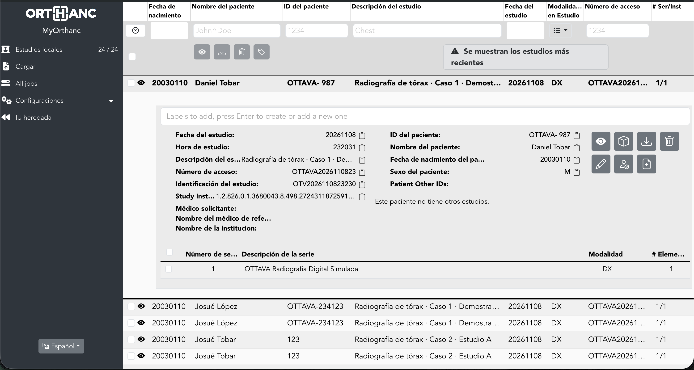
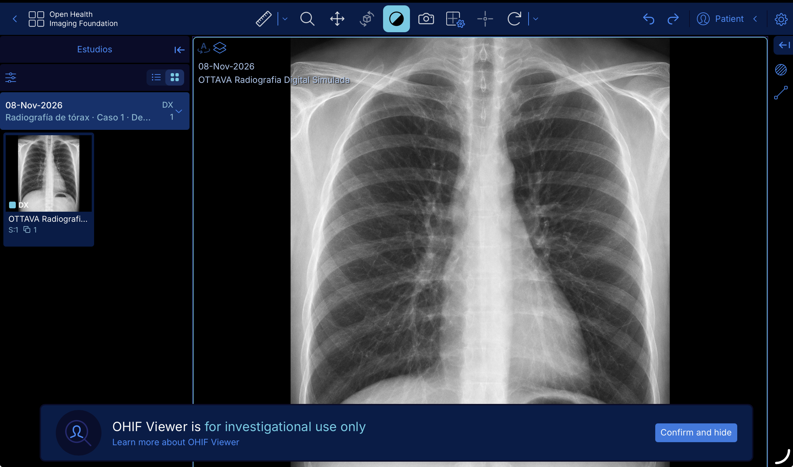
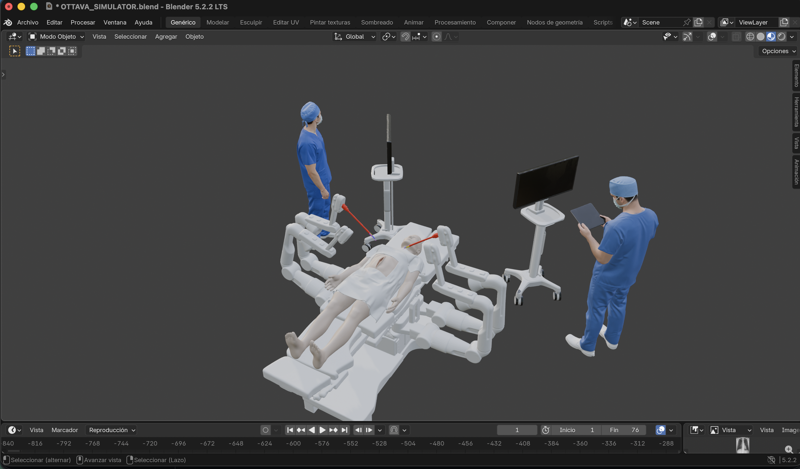
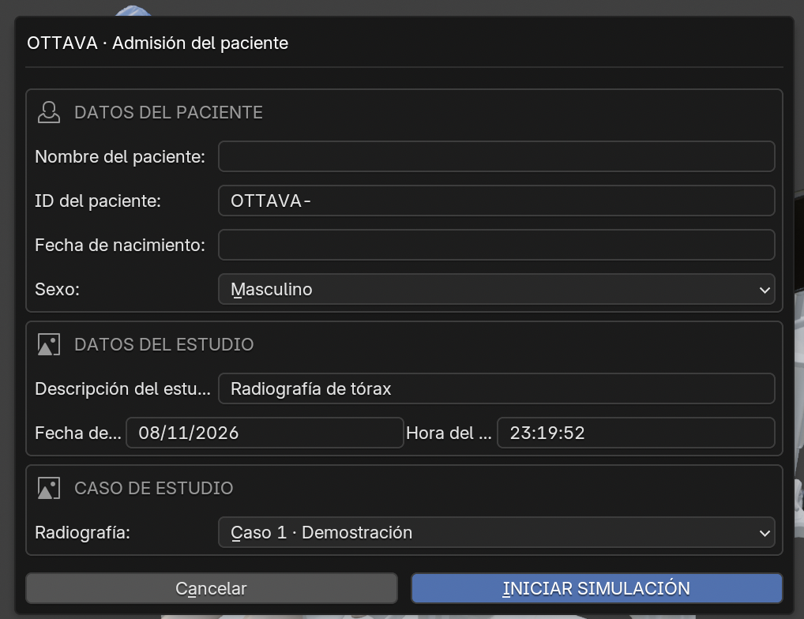
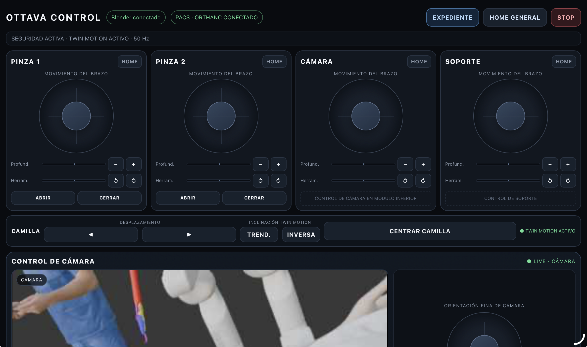
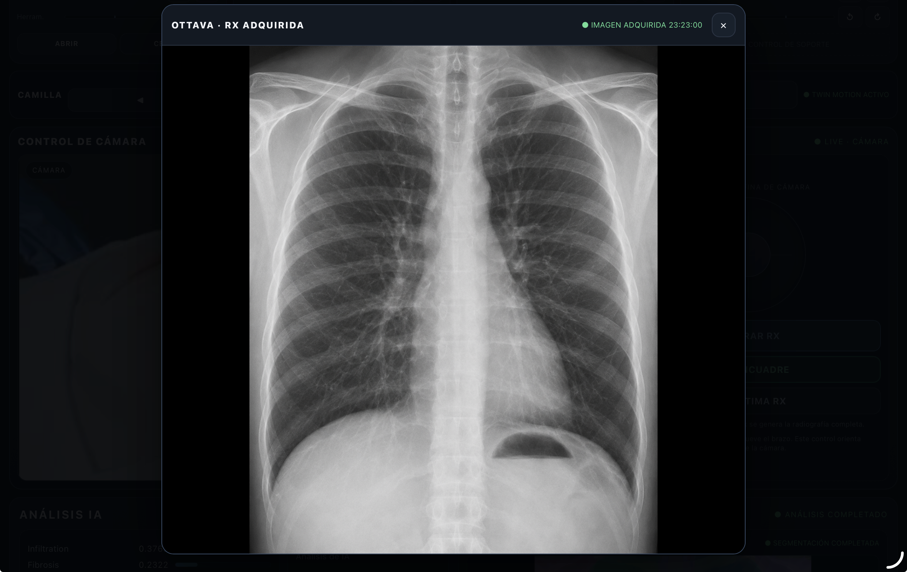
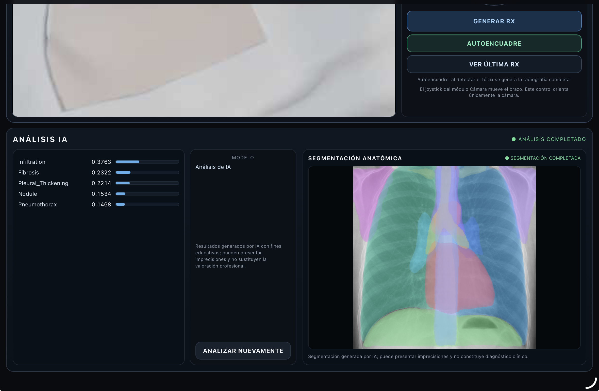
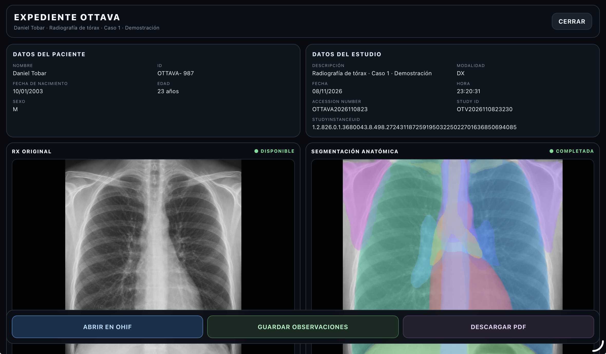
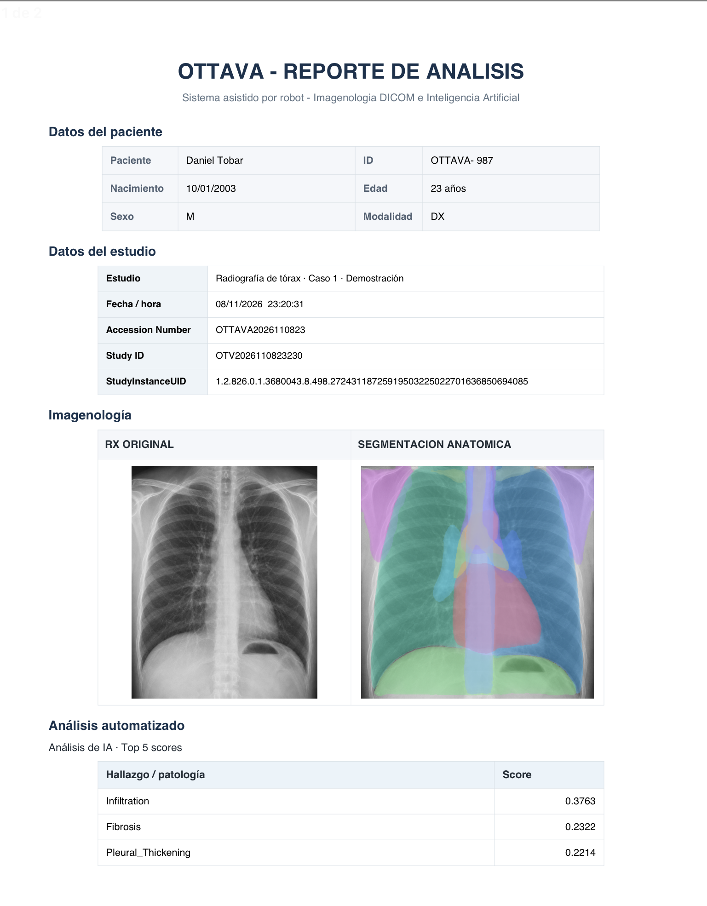

# Guía de Usuario — OTTAVA

Esta guía describe el procedimiento básico para iniciar y utilizar el simulador OTTAVA.

Para información detallada sobre instalación y replicación consulte el [documento técnico](docs/documento_tecnico.md).

## 1. Requisitos

Para ejecutar OTTAVA se requiere:

- Blender.
- Python 3.
- Dependencias incluidas en `requirements.txt`.
- Orthanc PACS.
- Docker.
- Navegador web.

En esta guía:

```text
<ruta_del_repositorio>
```

representa la carpeta donde fue clonado el proyecto.

## 2. Iniciar Orthanc

Inicie el servidor Orthanc utilizado por OTTAVA.

Compruebe su funcionamiento desde:

```text
http://localhost:8042
```

Orthanc almacena los estudios DICOM generados durante la simulación.



## 3. Iniciar OHIF

Abra Terminal y ejecute:

```bash
cd <ruta_del_repositorio>/src/simulacion/api/visor/ohif
chmod +x start-ohif.command stop-ohif.command
./start-ohif.command
```

OHIF estará disponible normalmente en:

```text
http://localhost:3000
```



## 4. Iniciar la API

Abra otra Terminal:

```bash
cd <ruta_del_repositorio>/src/simulacion/api
```

Active el entorno virtual de Python correspondiente y ejecute:

```bash
python3 ottava_api.py
```

Mantenga esta Terminal abierta durante toda la simulación.

## 5. Abrir el simulador

Abra en Blender:

```text
src/simulacion/OTTAVA_SIMULATOR.blend
```

La escena contiene el robot OTTAVA, paciente, mesa quirúrgica, cámara y demás elementos utilizados durante la simulación.



Ejecute el controlador de OTTAVA para habilitar la comunicación entre Blender y la aplicación web.

## 6. Registrar el paciente

Ingrese los datos ficticios solicitados en la ventana de admisión y seleccione uno de los casos disponibles.



Los datos utilizados durante las pruebas deben corresponder únicamente a simulaciones.

## 7. Utilizar el control remoto

Desde la aplicación web es posible controlar:

- PINZA 1.
- PINZA 2.
- CÁMARA.
- SOPORTE.
- Mesa quirúrgica.
- Orientación de cámara.
- Generación de RX.



Utilice los controles para posicionar los elementos del robot dentro de la escena.

## 8. Generar la radiografía

Posicione la cámara del brazo 03 sobre la región que desea utilizar para la simulación.

Seleccione:

```text
GENERAR RX
```

OTTAVA realizará la adquisición radiográfica simulada y generará el estudio correspondiente.



## 9. Consultar el análisis de IA

Después de generar el estudio, OTTAVA procesa la imagen y presenta los resultados del análisis y la segmentación anatómica.



Los resultados tienen fines exclusivamente educativos y pueden presentar imprecisiones.

## 10. Consultar el expediente

El expediente reúne la información relacionada con el estudio generado.



Desde este módulo es posible:

- Consultar la radiografía.
- Revisar los resultados de IA.
- Abrir el estudio en OHIF.
- Registrar observaciones.
- Guardar observaciones.
- Generar el reporte PDF.

## 11. Visualizar el estudio en OHIF

Seleccione la opción correspondiente para abrir el estudio DICOM en OHIF.


El visor permite consultar las imágenes almacenadas previamente en Orthanc.

## 12. Generar el reporte

Después de guardar las observaciones puede generarse el reporte correspondiente en PDF.



## 13. Nueva simulación

Para comenzar un nuevo procedimiento seleccione:

```text
NUEVA SIMULACIÓN
```

OTTAVA limpiará el estudio activo y regresará al proceso de admisión.

Los estudios previamente almacenados en Orthanc permanecen disponibles.

## Finalizar OTTAVA

Al terminar la simulación:

1. Cierre Blender.
2. Detenga la API utilizando `Ctrl + C`.
3. Detenga OHIF:

```bash
cd <ruta_del_repositorio>/src/simulacion/api/visor/ohif
./stop-ohif.command
```

4. Cierre Orthanc si ya no será utilizado.

---

**OTTAVA es un entorno académico de simulación. No debe utilizarse para diagnóstico, atención clínica ni toma de decisiones médicas.**