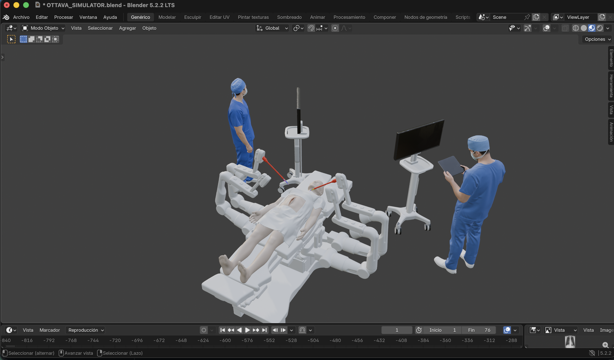

# OTTAVA

## Sistema virtual asistido por robot con control remoto, imagenología DICOM e inteligencia artificial

OTTAVA es un simulador educativo de un sistema asistido por robot desarrollado en Blender. Integra control remoto, simulación quirúrgica, adquisición radiográfica simulada, almacenamiento DICOM, análisis mediante inteligencia artificial y visualización de expedientes en un único flujo funcional.

El proyecto corresponde a la Fase 3 del curso **Sistemas Inteligentes** de la carrera de Ingeniería Biomédica de la Universidad Mariano Gálvez de Guatemala.

> **Proyecto de carácter educativo y de investigación. No está destinado a uso clínico ni sustituye la valoración de profesionales de la salud.**

---

## Vista general



**Autor:** Josue Daniel Tobar Lopez
**Curso:** Sistemas Inteligentes  
**Universidad:** Universidad Mariano Gálvez de Guatemala  
**Año:** 2026  
**Video demostrativo:** Pendiente de agregar

---

## Descripción del proyecto

OTTAVA transforma un prototipo virtual de cirugía asistida por robot en un sistema integrado capaz de ejecutar un flujo completo desde la interacción con el simulador hasta el almacenamiento y análisis de una imagen médica.

El sistema permite:

- controlar remotamente los brazos robóticos;
- manipular instrumentos y cámara;
- controlar la posición de la camilla;
- registrar datos de un paciente ficticio;
- seleccionar distintos casos de estudio;
- simular la adquisición de una radiografía;
- convertir la imagen generada a formato DICOM;
- almacenar el estudio en un servidor PACS Orthanc;
- ejecutar análisis de patologías mediante inteligencia artificial;
- realizar segmentación de estructuras anatómicas;
- consultar el expediente, imágenes y resultados;
- abrir el estudio en OHIF Viewer;
- registrar observaciones profesionales;
- generar un reporte en PDF;
- iniciar una nueva simulación sin eliminar los estudios previamente almacenados.

---

## Arquitectura general

```text
APP MÓVIL
    ↓
FASTAPI
    ↓
BLENDER / OTTAVA
    ↓
CONTROL ROBÓTICO
    ↓
ARM_03_CAMERA
    ↓
GENERAR RX
    ↓
DICOM
    ↓
ORTHANC PACS
    ↓
INTELIGENCIA ARTIFICIAL
    ├── DenseNet121
    └── PSPNet
    ↓
EXPEDIENTE
    ├── OHIF
    ├── Observaciones
    └── PDF
```

El diagrama completo de arquitectura se encuentra en:

```text
docs/arquitectura.png
```

---

## Componentes implementados

| Componente | Implementación en OTTAVA |
|---|---|
| Control remoto | Aplicación móvil conectada mediante red local |
| Simulación | 4 brazos robóticos, paciente, personal médico, 2 monitores y camilla |
| Sensor óptico | Cámara virtual instalada en ARM 03 |
| DICOM | Generación mediante Python y pydicom |
| PACS | Orthanc |
| Inteligencia artificial | Clasificación de patologías y segmentación anatómica |
| Expediente | Interfaz web propia |
| Visor DICOM | OHIF Viewer |
| Reporte | Generación de PDF |
| Casos de estudio | 4 radiografías seleccionables desde Admisión |

---

## Control remoto

OTTAVA dispone de una aplicación web diseñada para utilizarse desde un teléfono móvil conectado a la misma red local que el equipo donde se ejecuta Blender.

La aplicación permite controlar de manera independiente:

### PINZA 1
Control del primer brazo robótico y apertura/cierre de pinza.

### PINZA 2
Control del segundo brazo robótico y apertura/cierre de pinza.

### CÁMARA
Movimiento del brazo encargado de posicionar el sensor óptico.

La cámara utilizada para la adquisición virtual se encuentra asociada al objeto:

```text
Arm_03_Camera
```

### SOPORTE
Control del cuarto brazo del sistema.

### CAMILLA
Permite modificar la posición de la mesa y utilizar el movimiento sincronizado o Twin Motion.

El sistema incluye además:

- HOME;
- STOP;
- límites de movimiento;
- protección mediante detección de colisiones;
- almacenamiento de última posición segura.

---

## Admisión del paciente

Antes de iniciar una simulación se muestra la ventana **Admisión del paciente**.

Los datos utilizados son ficticios y permiten asociar posteriormente la adquisición DICOM con un expediente.

Los campos incluyen:

- nombre;
- ID;
- fecha de nacimiento;
- sexo;
- descripción del estudio;
- fecha del estudio;
- hora del estudio;
- caso de estudio.

---

## Casos de estudio

OTTAVA dispone de cuatro casos radiográficos seleccionables desde la ventana de Admisión:

```text
Caso 1 · Demostración
Caso 2 · Estudio A
Caso 3 · Estudio B
Caso 4 · Estudio C
```

Cada caso se encuentra asociado a una radiografía diferente.

La representación visual utilizada dentro de Blender se normaliza al área del `XRay_Overlay` para mantener una región de trabajo uniforme durante el posicionamiento del sensor.

Las imágenes originales permanecen intactas para el procesamiento posterior.

---

## Generación de RX

La adquisición se ejecuta desde la aplicación mediante:

```text
GENERAR RX
```

OTTAVA dispone de dos modos.

### Adquisición manual

Con **Autoencuadre desactivado**, la posición de `Arm_03_Camera` determina la región de estudio.

El sistema calcula el área observada por el sensor y utiliza las mismas coordenadas relativas para obtener la región correspondiente de la radiografía original.

### Autoencuadre

Con **Autoencuadre activado**, el sistema identifica que el sensor se encuentra sobre la región de estudio y recupera automáticamente la radiografía completa correspondiente al caso seleccionado.

---

## DICOM

Después de generar la RX, OTTAVA convierte la imagen en un archivo DICOM válido.

Los archivos incluyen información del paciente ficticio y del estudio, entre ella:

- Patient Name;
- Patient ID;
- Patient Sex;
- Patient Birth Date;
- Study Date;
- Study Time;
- Study Description;
- Modality;
- Study Instance UID;
- Series Instance UID;
- SOP Instance UID.

La modalidad utilizada es:

```text
DX
```

Las imágenes se almacenan utilizando:

```text
MONOCHROME2
```

Posteriormente el estudio es enviado al servidor PACS.

---

## Orthanc PACS

OTTAVA utiliza **Orthanc** como servidor PACS local.

Orthanc permite:

- recibir estudios;
- almacenar imágenes DICOM;
- consultar pacientes;
- consultar estudios y series;
- utilizar DICOMweb;
- integrar el almacenamiento con OHIF.

Dirección local predeterminada:

```text
http://localhost:8042
```

---

## Inteligencia artificial

Después de generar el estudio se ejecuta automáticamente el módulo:

```text
ANÁLISIS DE IA
```

### Clasificación

Se utiliza un modelo basado en:

```text
DenseNet121
```

El sistema genera probabilidades asociadas a diferentes hallazgos radiográficos.

### Segmentación anatómica

Se utiliza:

```text
PSPNet
```

para producir una segmentación de estructuras anatómicas presentes en la radiografía.

> Los resultados generados por IA tienen fines educativos, pueden presentar imprecisiones y no constituyen un diagnóstico médico.

---

## Expediente del paciente

OTTAVA cuenta con una interfaz propia para consultar el estudio completo.

El expediente presenta:

- datos del paciente;
- edad calculada;
- información del estudio;
- radiografía original;
- segmentación anatómica;
- resultados del análisis de IA;
- observaciones profesionales.

---

## OHIF Viewer

Los estudios almacenados en Orthanc pueden abrirse mediante **OHIF Viewer** utilizando DICOMweb.

El botón:

```text
ABRIR EN OHIF
```

abre directamente el estudio correspondiente utilizando su `StudyInstanceUID`.

---

## Observaciones profesionales

El expediente permite ingresar:

- nombre del profesional;
- rol;
- observaciones sobre el estudio.

Las observaciones se almacenan de forma independiente para cada `StudyInstanceUID`.

---

## Reporte PDF

Después de guardar las observaciones se habilita la generación del reporte mediante:

```text
DESCARGAR PDF
```

El reporte incorpora:

- información del paciente;
- datos del estudio;
- radiografía;
- resultados de IA;
- segmentación;
- observaciones profesionales.

---

## Nueva simulación

La aplicación dispone del botón:

```text
NUEVA SIMULACIÓN
```

Esta función permite iniciar nuevamente el flujo con:

- paciente nuevo;
- información de estudio nueva;
- nuevo caso radiográfico.

Los estudios almacenados previamente en Orthanc no son eliminados.

---

## Tecnologías utilizadas

### Simulación y modelado
- Blender
- Python
- modelos GLB/GLTF

### Aplicación y comunicación
- FastAPI
- HTML
- CSS
- JavaScript
- red local

### Imagenología médica
- pydicom
- DICOM
- DICOMweb
- Orthanc PACS

### Inteligencia artificial
- PyTorch
- TorchXRayVision
- DenseNet121
- PSPNet

### Visualización
- OHIF Viewer
- Orthanc Explorer 2

### Infraestructura
- Docker
- Docker Desktop
- Nginx

---

## Flujo completo

```text
1. Iniciar Orthanc
        ↓
2. Iniciar OHIF
        ↓
3. Iniciar FastAPI
        ↓
4. Ejecutar OTTAVA_MASTER_FINAL.py
        ↓
5. Registrar paciente
        ↓
6. Seleccionar caso
        ↓
7. Iniciar simulación
        ↓
8. Controlar sistema desde la app
        ↓
9. Posicionar Arm_03_Camera
        ↓
10. Generar RX
        ↓
11. Crear DICOM
        ↓
12. Enviar estudio a Orthanc
        ↓
13. Ejecutar análisis de IA
        ↓
14. Generar segmentación
        ↓
15. Consultar expediente
        ↓
16. Abrir en OHIF
        ↓
17. Registrar observaciones
        ↓
18. Generar PDF
```

---

## Documentación

La documentación completa del proyecto se encuentra en:

- [Guía de usuario](GUIA_USUARIO.md)
- [Documento técnico](docs/documento_tecnico.md)
- [Licencia](LICENSE.md)

---

## Estructura del repositorio

```text
sistema-asistido-robot-OTTAVA/
│
├── README.md
├── GUIA_USUARIO.md
├── LICENSE.md
├── .gitignore
│
├── src/
│   └── simulacion/
│       ├── modelos/
│       └── api/
│           ├── requirements.txt
│           ├── dicom/
│           ├── ia/
│           ├── visor/
│           └── control/
│
├── datos/
│   ├── pacientes/
│   └── dicom_ejemplo/
│
└── docs/
    ├── documento_tecnico.md
    ├── arquitectura.png
    └── img/
```

---

## Datos de demostración

El proyecto utiliza exclusivamente:

- pacientes ficticios;
- imágenes médicas de uso académico;
- datos de demostración.

No deben almacenarse datos identificables de pacientes reales.

La carpeta:

```text
datos/dicom_ejemplo/
```

contendrá al menos tres estudios DICOM generados mediante OTTAVA.

---

## Evidencias

Las evidencias finales estarán disponibles en:

```text
docs/img/
```

Estas incluirán capturas de:

- escena completa;
- control remoto;
- adquisición RX;
- estudio DICOM;
- Orthanc;
- análisis de IA;
- segmentación;
- expediente;
- OHIF;
- reporte PDF.

---

## Video demostrativo

El video final mostrará el flujo completo:

```text
Control
→ Simulación
→ Adquisición
→ DICOM
→ Orthanc
→ IA
→ Segmentación
→ Expediente
→ OHIF
```

**Duración:** 3 a 5 minutos.

**Enlace:** Pendiente de agregar.

---

## Limitaciones

OTTAVA es un simulador académico y presenta las siguientes limitaciones:

- no representa físicamente la interacción real entre radiación ionizante y tejidos;
- la adquisición radiográfica es simulada;
- los modelos de inteligencia artificial pueden presentar errores;
- los resultados de IA no deben interpretarse como diagnósticos;
- la simulación no representa un dispositivo médico certificado;
- el desempeño depende del hardware utilizado para ejecutar Blender y los servicios asociados.

---

## Uso educativo

Este proyecto es de carácter exclusivamente educativo.

No está destinado a uso clínico, no utiliza datos reales de pacientes y no está afiliado, patrocinado ni aprobado por fabricantes de plataformas robóticas, sistemas PACS o dispositivos médicos.

Los resultados generados mediante inteligencia artificial no sustituyen la interpretación de un profesional de la salud.

---

## Licencia

El código desarrollado para OTTAVA se distribuye bajo la:

**MIT License**

Consultar:

[LICENSE.md](LICENSE.md)

Las herramientas, bibliotecas, modelos y componentes de terceros mantienen sus respectivas licencias.