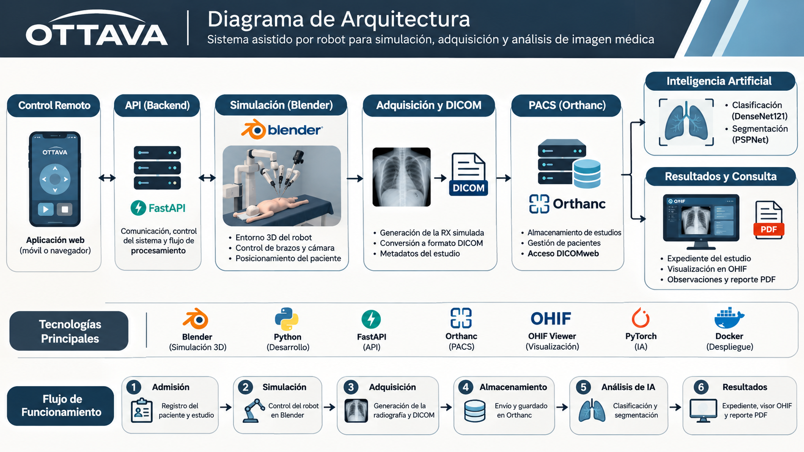

# Documento técnico — OTTAVA

> Documento en preparación. Este archivo contendrá las instrucciones para replicar el proyecto.

## 1. Objetivo

## 2. Arquitectura del sistema

## 3. Requisitos de hardware

## 4. Requisitos de software y versiones

## 5. Estructura del repositorio

## 6. Instalación paso a paso

## 7. Configuración del control remoto

## 8. Configuración de Blender

## 9. Casos radiográficos

## 10. Generación DICOM

## 11. Configuración de Orthanc

## 12. Inteligencia artificial

## 13. Segmentación anatómica

## 14. Expediente y PDF

## 15. Configuración de OHIF

## 16. Pruebas y resultados

## 17. Limitaciones

## 18. Componentes óptimos implementados

## 19. Fuentes y licencias de terceros
